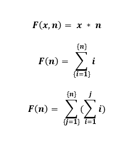

# Лабораторная 1 Paradigma Funcțională (ecuații)

Программа на **Python 3.10+** в функциональном стиле. Сторонние библиотеки не нужны.

Подробное объяснение кода с нуля, по шагам и с вопросами к защите — в
[DOCUMENTATION.md](DOCUMENTATION.md).

## Запуск

В папке `lab1`:

```sh
sh run.sh        # N вводится с клавиатуры, Enter — N = 10
sh run.sh 7      # N передаётся аргументом (1..500)
sh run.sh test   # тесты
```

На Windows: `py main.py 7` и `py -m unittest tests -v`.

## Файлы

| Файл | Содержимое |
| --- | --- |
| `liste_finite.py` | 1. Построение конечных списков |
| `siruri.py` | 2. Функции вычисления последовательностей (формулы с картинки) |
| `operatii_liste.py` | 3. `GetN`, `Set`, `OddEven`, `FuncList` |
| `main.py` | Демонстрация всех пунктов для заданного N |
| `tests.py` | Тесты `unittest` |

## Что реализовано

### 1. Construcția listelor finite (2 балла)

- a. `patrate(N)` — квадраты натуральных чисел `1..N`: `patrate(5) = [1, 4, 9, 16, 25]`.
- b. `factoriale(N)` — факториалы `1!..N!`: `factoriale(5) = [1, 2, 6, 24, 120]`.
  Каждый следующий элемент получается из предыдущего через `reduce`: `k! = (k-1)! · k`.

### 2. Funcții de calcul al șirurilor (3 балла)



Каждая формула записана как рекуррентное уравнение:

| Формула | Уравнения | Функция |
| --- | --- | --- |
| F(x, n) = x · n | F(x, 0) = 0, F(x, n) = x + F(x, n − 1) | `produs(x, n)` |
| F(n) = Σ(i=1..n) i | F(0) = 0, F(n) = n + F(n − 1) | `suma(n)` |
| F(n) = Σ(j=1..n) Σ(i=1..j) i | F(0) = 0, F(n) = suma(n) + F(n − 1) | `suma_dubla(n)` |

`sir(f, N)` строит первые N членов последовательности: `sir(suma, 5) = [1, 3, 6, 10, 15]`,
`sir(suma_dubla, 5) = [1, 4, 10, 20, 35]`. Тесты сверяют результаты с формулами
`n(n+1)/2` и `n(n+1)(n+2)/6`.

### 3. Funcții pentru lucrul cu liste (5 баллов)

| Функция | Что делает | Пример |
| --- | --- | --- |
| `GetN(L, n)` | n-й элемент, нумерация с 1 | `GetN(['a','b','c'], 2) = 'b'` |
| `Set(L)` | одно вхождение каждого атома, порядок первого появления | `Set([3,1,3,2,1]) = [3, 1, 2]` |
| `OddEven(L)` | меняет местами соседей на нечётной и чётной позициях | `OddEven([1,2,3,4,5]) = [2, 1, 4, 3, 5]` |
| `FuncList(L1, L2, F)` | применяет F к элементам на одной позиции | `FuncList([1,2,3], [10,20,30], +) = [11, 22, 33]` |

`GetN` выбрасывает `IndexError`, если позиции нет в списке. В `FuncList` длина
результата равна длине более короткого списка.

## Функциональные принципы

- **Рекурсия вместо циклов**: в коде нет `for` и `while`.
- **Сопоставление с образцом** (`match`): список разбирается на голову и хвост `[cap, *coada]`,
  как `car`/`cdr` в Lisp или `(x:xs)` в Haskell.
- **Функции высшего порядка**: `map`, `filter`, `reduce`; `FuncList` и `sir` принимают функцию аргументом.
- **Лямбда-функции**: `lambda x: x * x`, `lambda a, b: b - a`.
- **Чистые функции и неизменяемость**: входные списки не меняются, всегда возвращается
  новый список. Это тоже проверяется тестами.

Ограничение N ≤ 500 связано с глубиной рекурсии в Python (по умолчанию около 1000 вызовов).
